# Cauri Wallet — Self-Attestation Evidence

Wallet name: `cauri`
Last updated: 2026-10-23

---

## CC support `cc_support`

> Send, receive, and hold Canton Coin.
>
> Suggested test: Send CC to and from the wallet. Record the transaction
> update IDs and optionally provide screenshots of the holding, transfer, and
> party ID.

- Transaction update ID(s): `1220508221c40904a758ad02d2ca81b97c9367e2b8b9272aae8f366e95a98a32f25a` (direct receive of 5.00 CC, 23 Oct 2026 11:50) — full ID via **View on Explorer** in the wallet
- Party ID(s): `cauri-sparrow::1220967b5c57730773375a12fef6982ef86142fe61ba94b00c4534f20a7f71ac810d`, counterparty `cauri-nectar::122028...087848`
- Explorer link(s): https://ccview.io/updates/1220508221c40904a758ad02d2ca81b97c9367e2b8b9272aae8f366e95a98a32f25a/ — the party and its other transfers are public on https://ccview.io, search `cauri-sparrow`
- Screenshot(s) / video:
  - 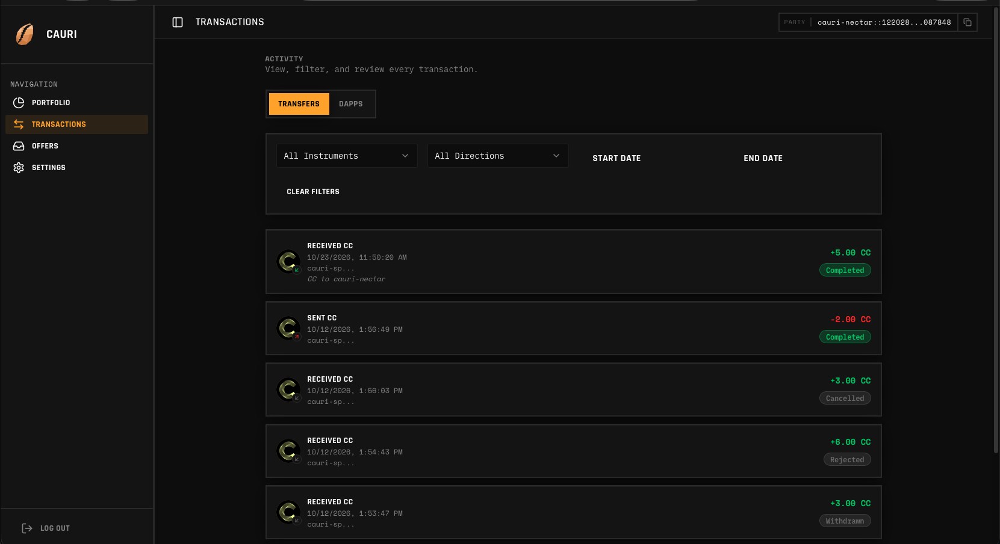 — activity list showing CC both sent and received
  - 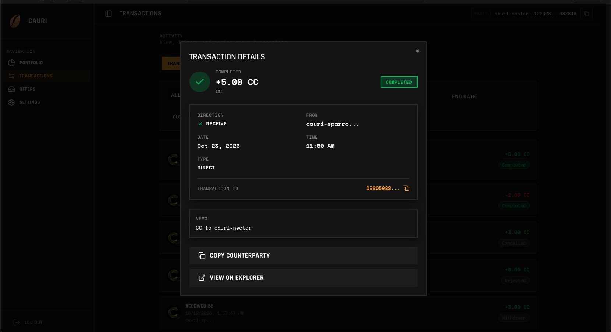 — transaction detail with direction, counterparty, transaction ID and memo
- Notes: Performed on Canton MainNet. The wallet holds and transfers CC in both directions; the explorer records 45 updates and CC moving to and from this party.

---

## Two-step CC transfers `two_step_cc_transfers`

> Send CC as an offer the receiver accepts, rather than a single atomic send.
> Cauri picks the form from the registry's transfer factory: a receiver with a
> CC pre-approval settles directly, and one without gets a two-step offer.
>
> Suggested test: Perform a two-step CC transfer (propose/create followed by a
> separate accept/settle step, rather than a single atomic send). Record the
> transaction update ID(s) for both steps and optionally provide screenshots of
> each.

- Transaction update ID(s): `12207179c343628be57eb323653953b0cdd2b1a1008088d68c8e31aa11401ee90928` — the settling transaction, once the recipient accepted (23 Oct 2026 11:42, type `OFFER`). The sender and the recipient both record this same ID
- Party ID(s): sender `cauri-sparrow::1220967b5c57730773375a12fef6982ef86142fe61ba94b00c4534f20a7f71ac810d`, recipient `cauri-sparrow-2::1220514f1f60d7514b43a7193b0cc...c23c7e`
- Explorer link(s): https://ccview.io/updates/12207179c343628be57eb323653953b0cdd2b1a1008088d68c8e31aa11401ee90928/
- Screenshot(s) / video:
  - 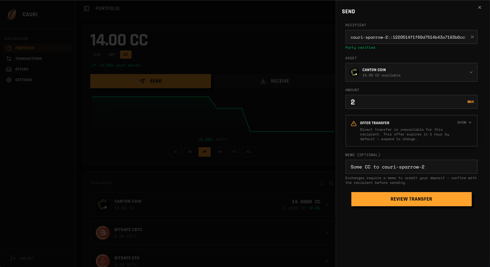 — the wallet states `Direct transfer is unavailable for this recipient`, so the transfer becomes an offer
  - 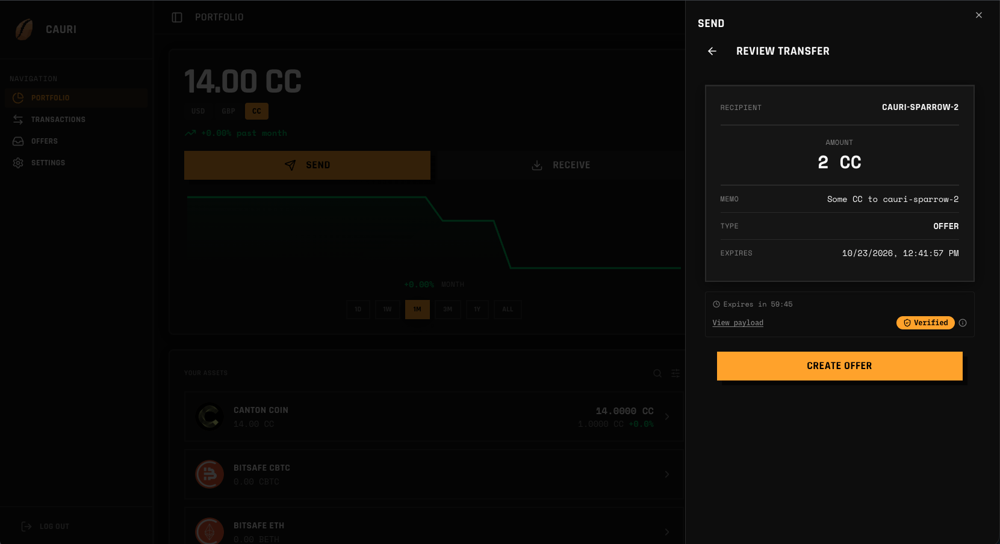 — review shows `TYPE: OFFER` with an expiry
  - 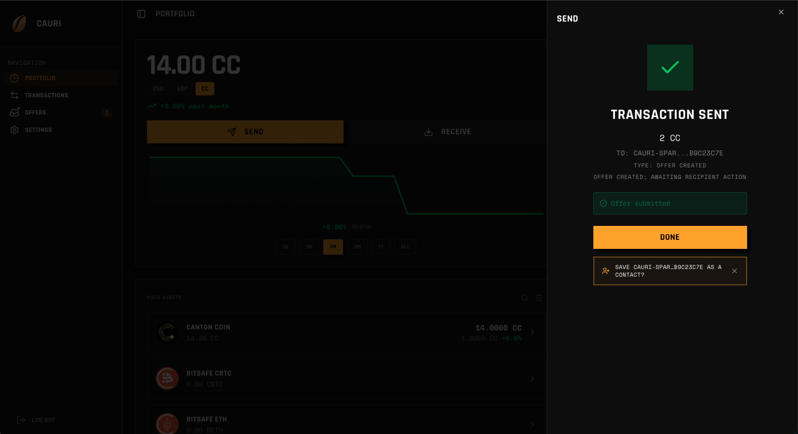 — `OFFER CREATED; AWAITING RECIPIENT ACTION` — step 1 complete, not settled
  - 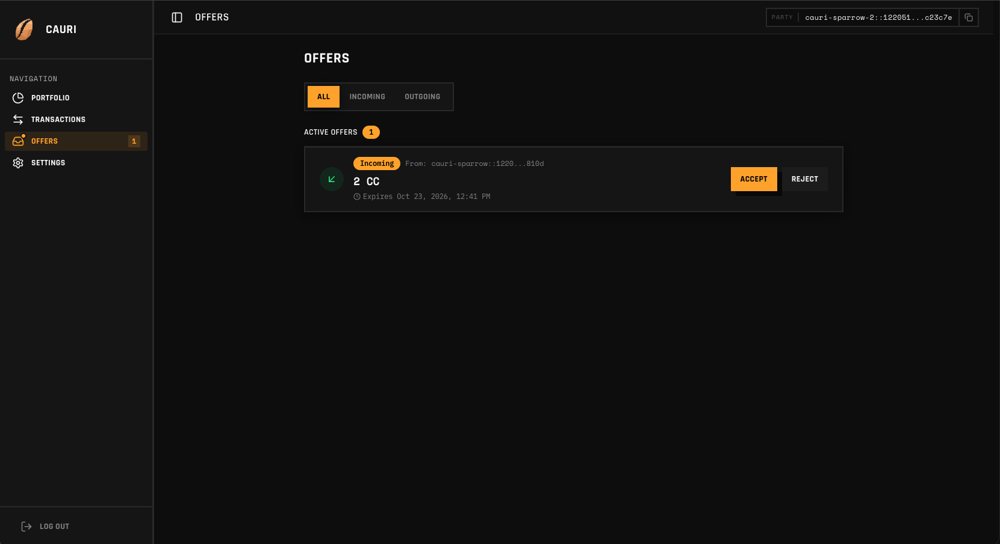 — the recipient sees an incoming offer awaiting Accept or Reject
  - 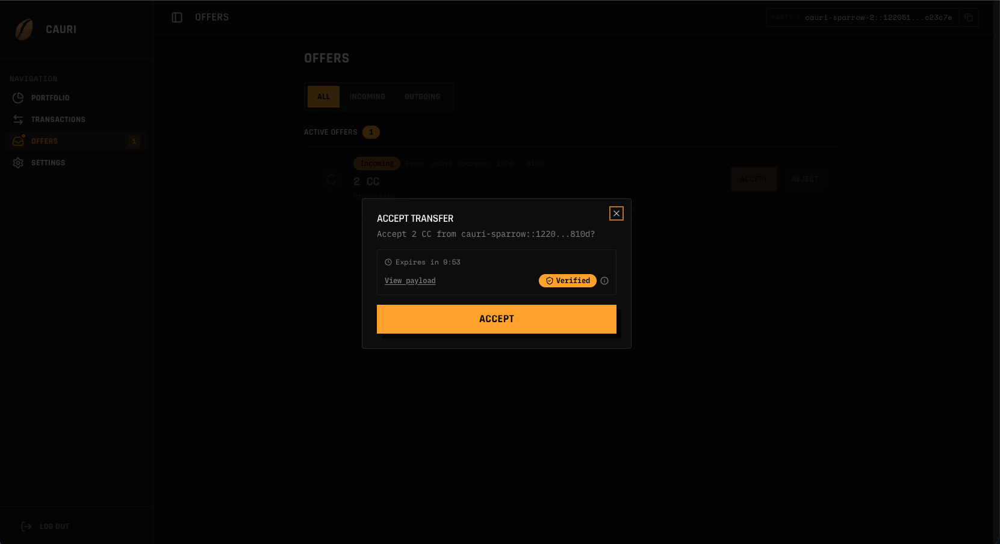 — the recipient accepts — step 2
  - 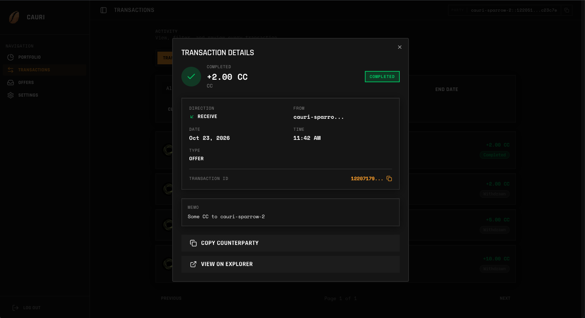 — now `COMPLETED`, `+2.00 CC`, `TYPE: OFFER`
- Notes: Performed on Canton MainNet, 23 Oct 2026. 2 CC from `cauri-sparrow` to `cauri-sparrow-2`, which holds no CC pre-approval — so the transfer was created as an offer and settled only on the recipient's separate acceptance. Two distinct ledger transactions. Compare `preapprovals` below, where the same wallet sends to a pre-approved party and the transfer settles directly in one step.

---

## Pre-approvals for CC `preapprovals`

> Auto-accept incoming CC without manual confirmation. Distinct from
> registry_preapprovals (App Specific) below.
>
> Suggested test: Enable pre-approvals for CC. Send CC to the wallet address.
> Confirm the transfer was auto-accepted. Record the transaction update IDs
> and optionally provide screenshots of the holding, transfer, and party ID.

- Transaction update ID(s): `1220508221c40904a758ad02d2ca81b97c9367e2b8b9272aae8f366e95a98a32f25a` (23 Oct 2026 11:50, type `DIRECT`) — full ID via **View on Explorer**
- Party ID(s): sender `cauri-sparrow::1220967b5c57730773375a12fef6982ef86142fe61ba94b00c4534f20a7f71ac810d`, recipient `cauri-nectar::122028...087848`
- Explorer link(s): https://ccview.io/updates/1220508221c40904a758ad02d2ca81b97c9367e2b8b9272aae8f366e95a98a32f25a/
- Screenshot(s) / video:
  - 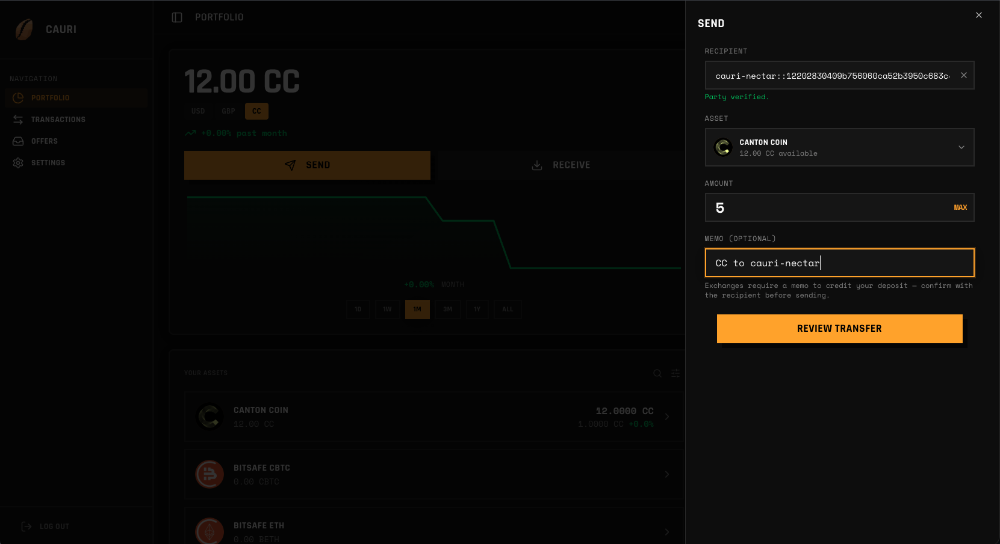 — no offer notice, unlike the same screen for a party without a pre-approval
  - 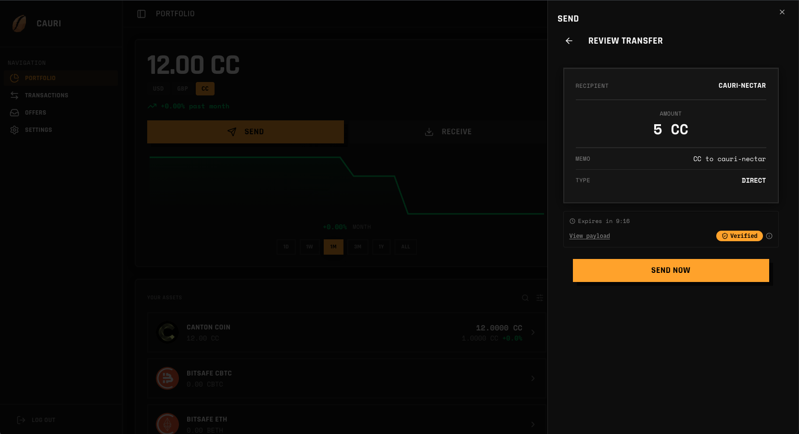 — review shows `TYPE: DIRECT`
  - 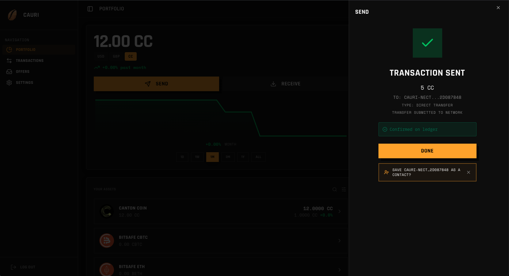 — `TYPE: DIRECT TRANSFER`, `Confirmed on ledger`, with no recipient action
- Notes: Performed on Canton MainNet, 23 Oct 2026. 5 CC to `cauri-nectar`, which holds a CC pre-approval; the transfer auto-settled with no acceptance step. The wallet decides direct against offer from the registry's transfer factory, so this is the same send flow taking the pre-approved path.

---

## CIP-0056 token standard transfer support `cip_0056_transfer`

> Send and receive any CIP-0056 token, not just CC.
>
> Suggested test: Send a CIP-0056-compatible token (not Canton Coin) to and
> from the wallet. Record the transaction update IDs and optionally provide
> screenshots of the holding, transfer, and party ID.

- Transaction update ID(s): `1220fe1bfb23749440cc7703cb78653e9de18ce50a648b14d481d071ff77547ffecb` (1.00 USDCx received and settled, 23 Oct 2026 12:30, type `OFFER`) — full ID via **View on Explorer**
- Party ID(s): sender `cauri-sparrow::1220967b5c57730773375a12fef6982ef86142fe61ba94b00c4534f20a7f71ac810d`, recipient `cauri-sparrow-2::1220514f1f60d7514b43a7193b0cc...c23c7e`
- Explorer link(s): https://ccview.io/updates/1220fe1bfb23749440cc7703cb78653e9de18ce50a648b14d481d071ff77547ffecb/
- Screenshot(s) / video:
  - 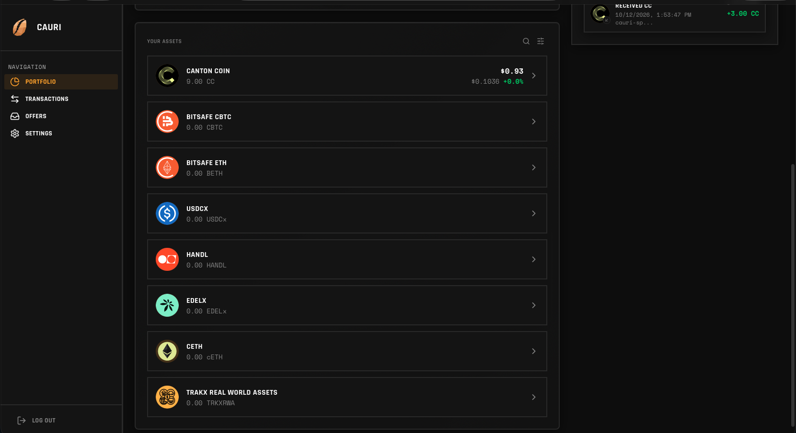 — the portfolio holds Canton Coin plus seven CIP-0056 tokens from separate registries, each shown by the symbol its registry publishes
  - 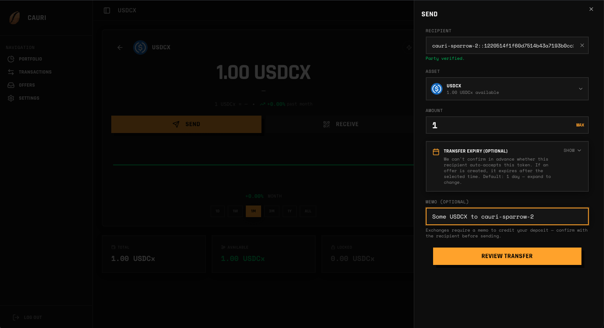 — sending USDCx, a non-CC CIP-0056 token, with its own balance and locked/available split
  - 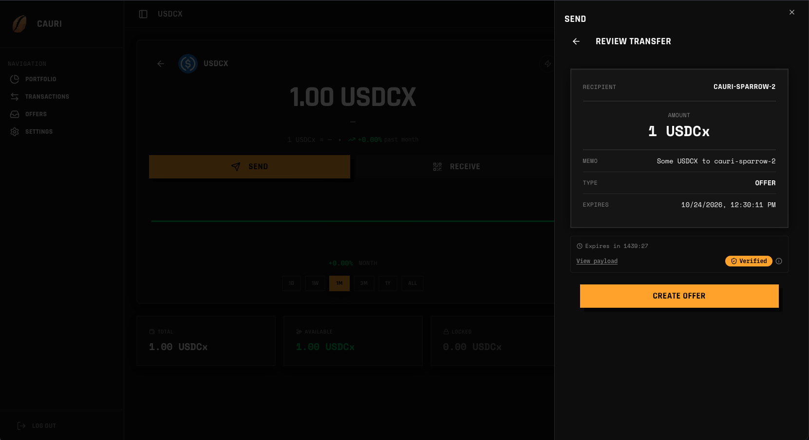 — review showing the asset as USDCx
  - 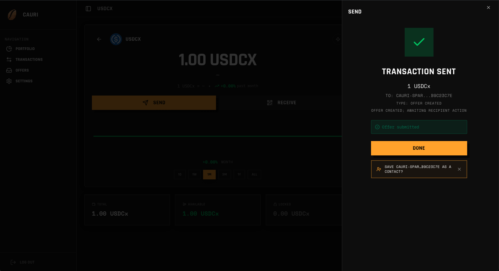 — offer created, awaiting the recipient
  - 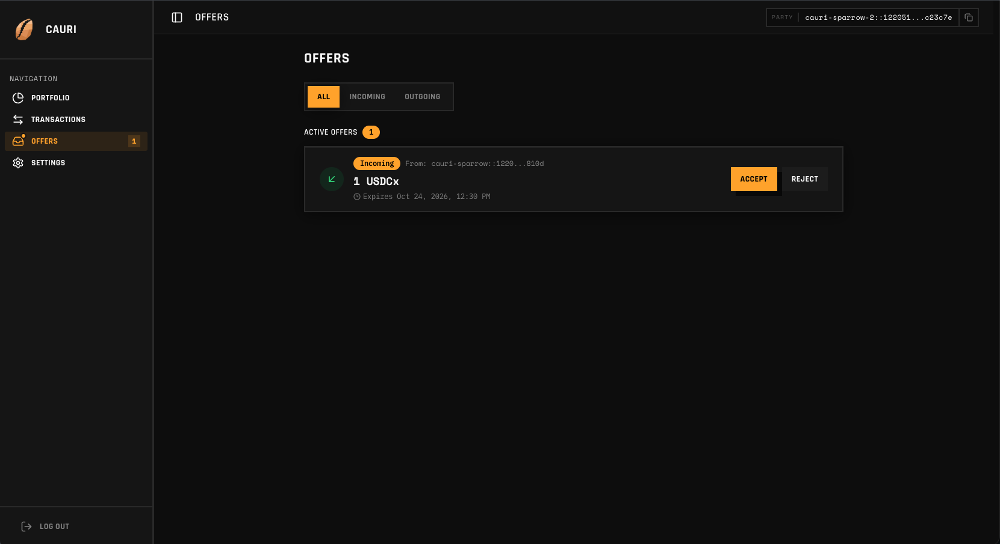 — the recipient's incoming USDCx offer
  - 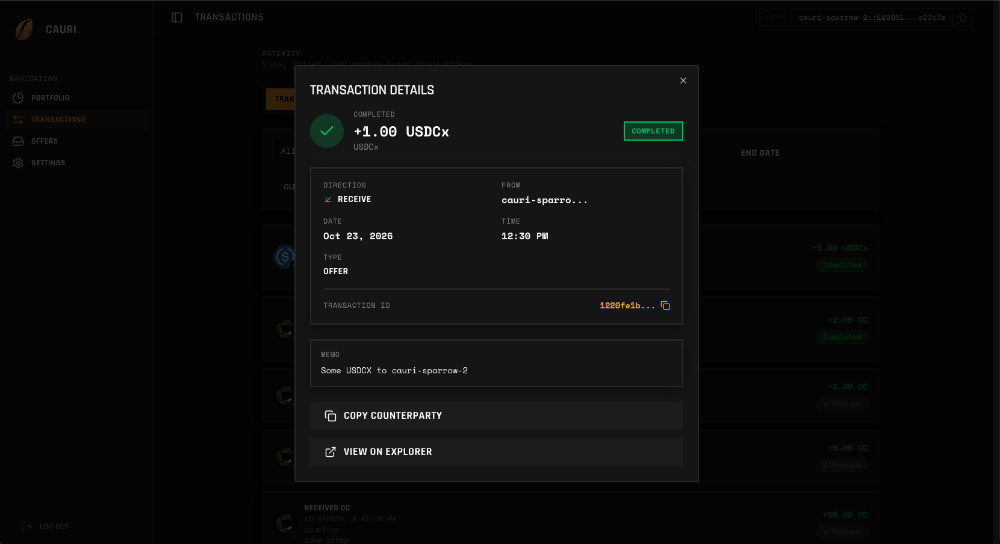 — settled, `+1.00 USDCx`, with its transaction ID and memo
- Notes: Performed on Canton MainNet, 23 Oct 2026. USDCx is a CIP-0056 token issued by a registry other than Canton Coin, so this exercises the token standard rather than the CC-specific path. The same send, offer and accept flow applies, and the wallet shows the token by its own symbol and balance. Documentation: https://docs.cauri.cc

---

## CIP-0103 dApp API support `cip_0103_dapp_api`

> Connect to and sign transactions from a third-party dApp via CIP-0103.
>
> Suggested test: Connect to a dApp using a CIP-0103 connection. Initiate a
> transaction from within the dApp and sign it from the wallet. Confirm the
> successful transaction. Optionally provide screenshots or a video
> recording.

- Transaction update ID(s): n/a — this claim is the CIP-0103 connection itself; transactions signed over a session are covered by `cip_0056_transfer` and `cc_support`
- Party ID(s): `cauri-prime::1220a75393543cba8f414fd8391ab09b463252e27126be5ba77886ef22ad11a9d339`
- Explorer link(s): n/a
- Screenshot(s) / video:
  - 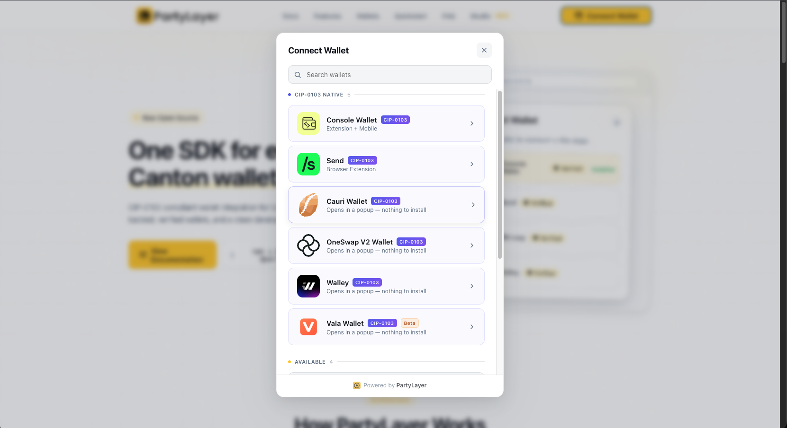 — PartyLayer's wallet picker lists Cauri Wallet under **CIP-0103 NATIVE**, alongside other CIP-0103 wallets
  - 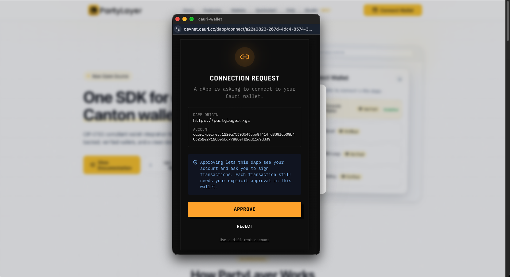 — the CIP-0103 connection request, naming the dApp origin and the account, and stating that each transaction still needs explicit approval
  - 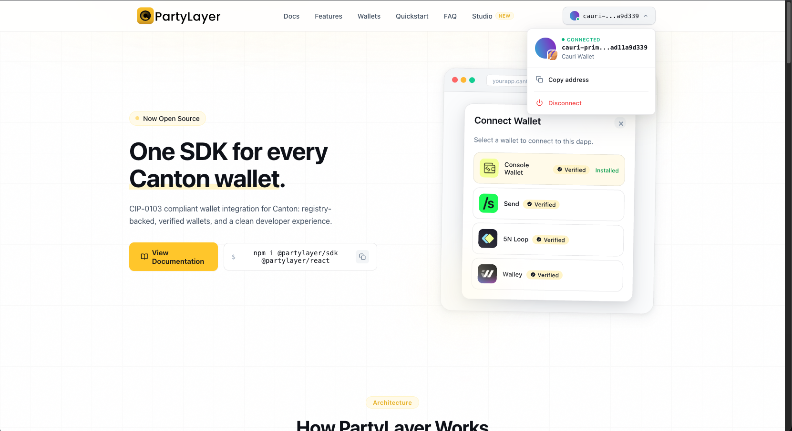 — the dApp reports the Cauri account as connected
  - 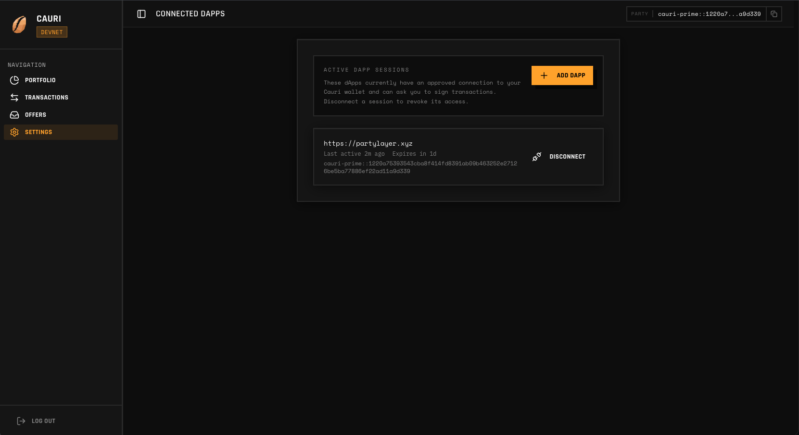 — the session listed in the wallet with its expiry and a Disconnect control
- Notes: Connected to https://partylayer.xyz, an independent CIP-0103 SDK, on 23 Oct 2026. Cauri implements CIP-0103 natively: a dApp connects through any CIP-0103 client without a Cauri-specific integration, which is why PartyLayer lists it among its native wallets — independent corroboration rather than our own claim. Approving a connection grants the dApp sight of the account and the ability to request signatures; every transaction still needs explicit approval in the wallet, and the session is revocable at any time. Documentation: https://docs.cauri.cc

---

## Wallet Connect support `walletconnect_support`

> Connect to and sign transactions from a third-party dApp via Wallet
> Connect.
>
> Suggested test: Connect to a dApp using Wallet Connect. Initiate a
> transaction from within the dApp and sign it from the wallet. Confirm the
> successful transaction. Optionally provide screenshots or a video
> recording.

- Transaction update ID(s): n/a — this claim is the pairing and session itself; transactions signed over the session are covered by `cip_0103_dapp_api`
- Party ID(s): `cauri-sparrow::1220967b5c57730773375a12fef6982ef86142fe61ba94b00c4534f20a7f71ac810d`
- Explorer link(s): n/a
- Screenshot(s) / video:
  - 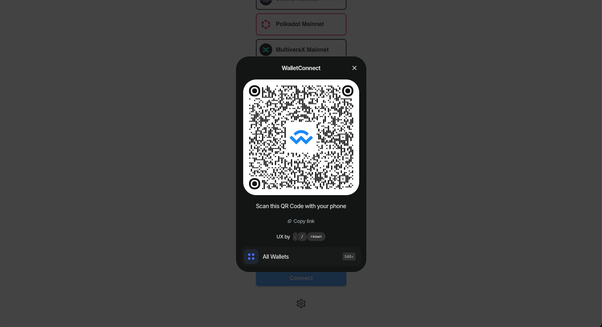 — the dApp (WalletConnect's own React sample app) offers a standard v2 pairing QR and URI
  - 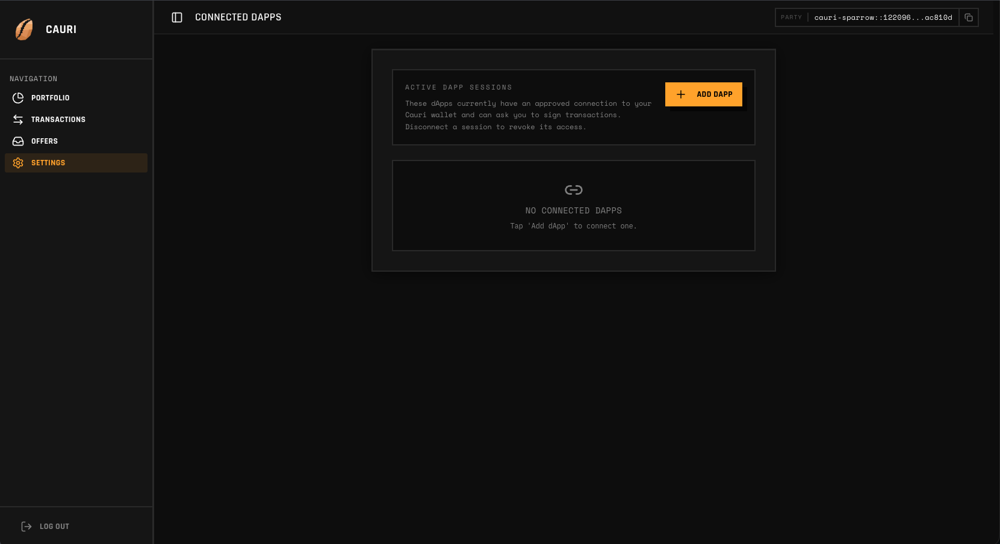 — no connected dApps before pairing
  - 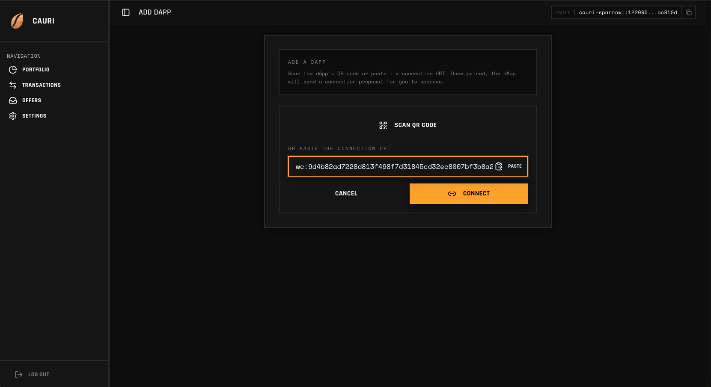 — the `wc:` URI pasted into the wallet, which also accepts a scanned QR
  - 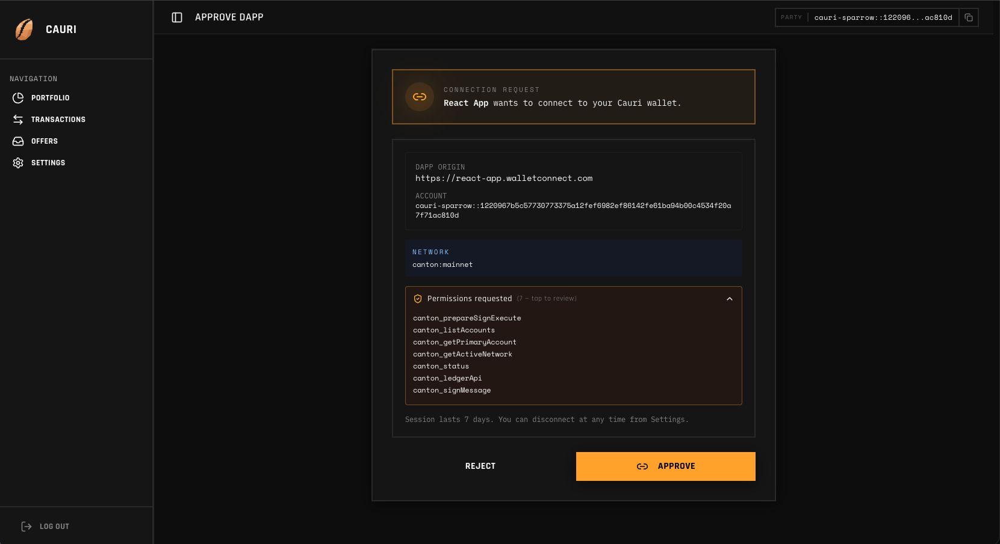 — the connection request, naming the dApp origin, the account, `canton:mainnet`, and each of the seven methods it asks for
  -  — the session listed as active, with its expiry and a Disconnect control
- Notes: Paired on Canton MainNet, 23 Oct 2026, with `https://react-app.walletconnect.com`. The wallet pairs over WalletConnect v2 by QR or pasted URI and requires the user to approve the connection before any method is callable. The approval names the exact methods granted — `canton_prepareSignExecute`, `canton_listAccounts`, `canton_getPrimaryAccount`, `canton_getActiveNetwork`, `canton_status`, `canton_ledgerApi`, `canton_signMessage` — so the grant is explicit rather than blanket. The session is time-bounded at 7 days and revocable at any time from Settings.

---

## Memo tag support for transfers to omnibus accounts `memo_tag_support`

> Attach a memo tag to a transfer, recorded under the
> splice.lfdecentralizedtrust.org/reason metadata.
>
> Suggested test: Include a memo tag in an asset transfer (this can be
> combined with the cc_support test). Record the transaction update ID
> showing the memo tag under the splice.lfdecentralizedtrust.org/reason
> metadata in the transaction JSON.

- Transaction update ID(s): `1220508221c40904a758ad02d2ca81b97c9367e2b8b9272aae8f366e95a98a32f25a` (memo `CC to cauri-nectar`) and `12207179c343628be57eb323653953b0cdd2b1a1008088d68c8e31aa11401ee90928` (memo `Some CC to cauri-sparrow-2`)
- Party ID(s): `cauri-sparrow::1220967b5c57730773375a12fef6982ef86142fe61ba94b00c4534f20a7f71ac810d`
- Explorer link(s): https://ccview.io/updates/1220508221c40904a758ad02d2ca81b97c9367e2b8b9272aae8f366e95a98a32f25a/ and https://ccview.io/updates/12207179c343628be57eb323653953b0cdd2b1a1008088d68c8e31aa11401ee90928/
- Screenshot(s) / video:
  -  — the memo field on the send form
  -  — the memo preserved on the received transaction, readable by the recipient
- Notes: Performed on Canton MainNet, 23 Oct 2026. The memo travels with the transfer and is shown to the recipient on the settled transaction, which is what an exchange needs to credit a deposit. Carried on both the direct and the offer transfer above.

---

## Pre-approvals for DA Registry issued assets `registry_preapprovals`

> Auto-accept incoming registry-issued (non-CC) assets. Distinct from
> preapprovals (Canton Coin) above.
>
> Suggested test: Register pre-approvals for a DA Registry issued asset.
> Send the asset to the wallet address. Confirm the asset was auto-accepted.
> Record the transaction update IDs and optionally provide screenshots of
> the holding, transfer, and party ID.

- Transaction update ID(s): enabling a pre-approval is signed on-ledger; the CC equivalent and its settled transfer are evidenced under `preapprovals`
- Party ID(s): `cauri-nectar-2::12207b...d85bba`
- Explorer link(s): https://ccview.io — search `cauri-sparrow`
- Screenshot(s) / video:
  - 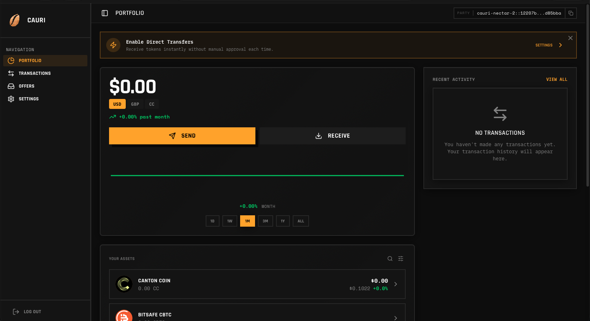 — with no pre-approval set, the wallet offers to enable direct transfers
  - 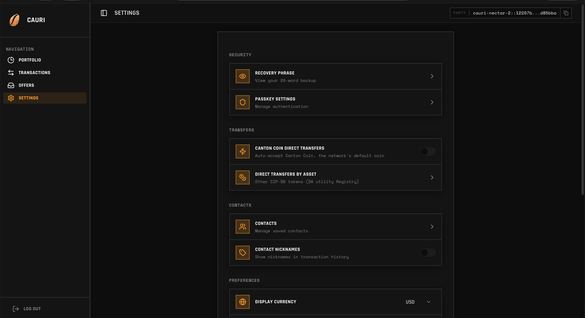 — Settings, both controls off: Canton Coin direct transfers, and **Direct Transfers by Asset — other CIP-56 tokens (DA Utility Registry)**
  - 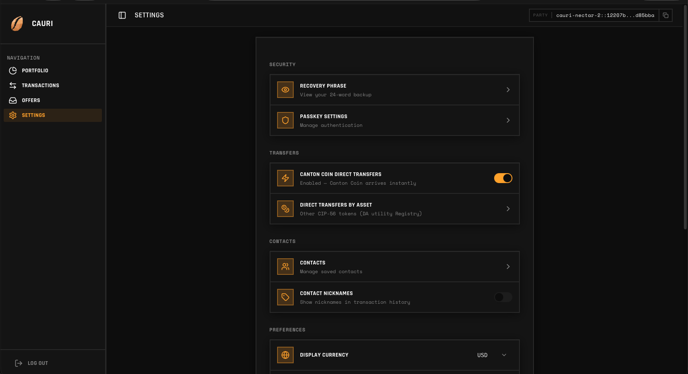 — Canton Coin direct transfers enabled; the wallet confirms Canton Coin now arrives instantly
- Notes: Gathered on Canton MainNet, 23 Oct 2026. Pre-approvals are per asset rather than global: Canton Coin has its own control, and DA Utility Registry issued assets are managed separately under Direct Transfers by Asset, so a user can accept one issuer's tokens automatically without accepting every token. Documentation: https://docs.cauri.cc

---

## UTXO merge delegation contract enabled `utxo_merge_delegation`

> The wallet enables the merge delegation contract so UTXOs can be
> consolidated on-chain, reducing UTXO bloat.
>
> Suggested test: Enable the merge delegation contract in the wallet.
> Witness a UTXO consolidation contract on-chain for CC (sender & receiver
> are the same party).

- Transaction update ID(s): none to cite — the authorization is not surfaced as a separate transfer in the wallet; its signing hash and decoded payload are in the screenshot below
- Party ID(s): `cauri-sparrow::1220967b5c57730773375a12fef6982ef86142fe61ba94b00c4534f20a7f71ac810d`
- Explorer link(s): n/a
- Screenshot(s) / video:
  - 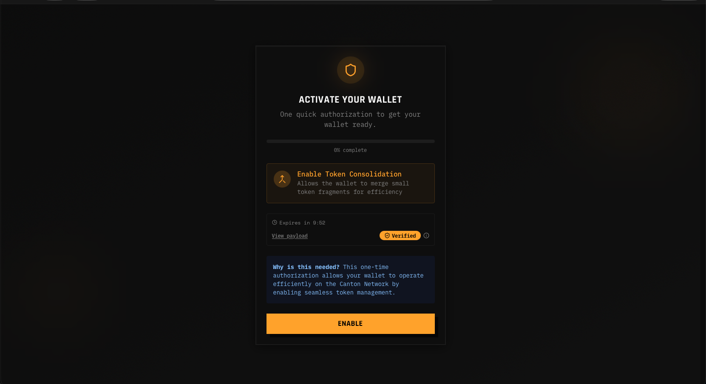 — the wallet asks for a one-time authorization to merge small token fragments, with an expiry and a Verified badge
- Notes: Performed on Canton MainNet, 23 Oct 2026. Enabling token consolidation delegates the merging of UTXO fragments so the wallet can operate efficiently without asking the user each time. It is a single explicit authorization, shown with its decoded payload before signing — see `clear_signing`. Documentation: https://docs.cauri.cc

---

## Clear signing `clear_signing`

> The wallet displays human-readable transaction details (not raw
> hex/opaque data) before signing.
>
> Suggested test: Show the wallet displaying human-readable transaction
> details (not raw hex/opaque data) before signing. Provide a screenshot of
> the clear-signing confirmation screen for a real transaction, alongside
> its transaction update ID.

- Transaction update ID(s): n/a — this claim is the signing surface itself
- Party ID(s): `cauri-sparrow::1220967b5c57730773375a12fef6982ef86142fe61ba94b00c4534f20a7f71ac810d`
- Explorer link(s): n/a
- Screenshot(s) / video:
  - 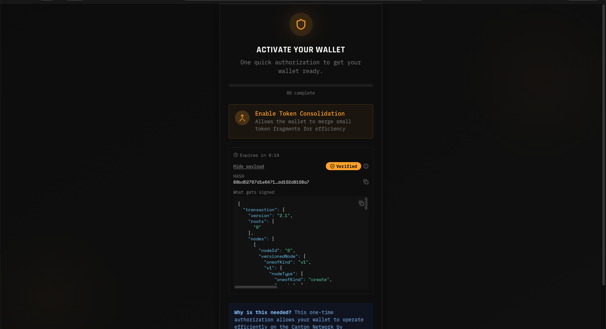 — **What gets signed**: the hash of the prepared transaction next to the decoded Daml transaction it commits to, expandable before approving
  -  — every transfer review names the recipient, amount, memo and transfer type, with a Verified badge
  -  — a dApp connection names the origin, the account, the network and each method granted
- Notes: Cauri shows what is actually being signed, not a summary written separately from it. Each approval carries a Verified badge, and **View payload** reveals the signing hash alongside the decoded transaction, so a user can confirm the displayed amount, asset and recipient correspond to the bytes their key commits to. Gathered on Canton MainNet, 23 Oct 2026. Documentation: https://docs.cauri.cc
